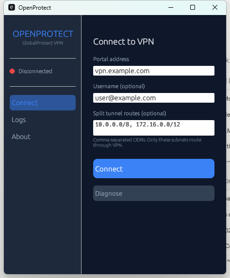
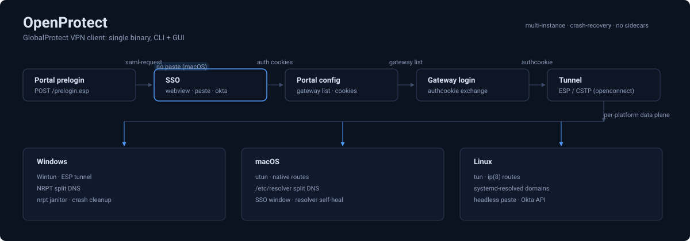

<p align="center">
  <h1 align="center">OpenProtect</h1>
  <p align="center">
    An open-source GlobalProtect VPN client for <b>Windows</b>, <b>Linux</b>, and <b>macOS</b>.<br>
    CLI + GUI desktop app, written in Rust.
  </p>
  <p align="center">
    <a href="https://github.com/kyaky/openprotect/actions/workflows/ci.yml"></a>
    <a href="https://github.com/kyaky/openprotect/releases/latest"></a>
    <a href="https://github.com/kyaky/openprotect/blob/main/LICENSE-MIT"></a>
  </p>
</p>

<p align="center">
  
</p>

**OpenProtect** connects to Palo Alto Networks GlobalProtect VPN portals, including **Prisma Access** with cloud authentication, from both a **desktop GUI** and a CLI (`opc`).

## Contents

- [Install](#install) (one-liners, pre-built binaries, build from source)
- [Quick start](#quick-start) (Windows, Linux, macOS, Okta headless, verify)
- [Desktop GUI](#desktop-gui)
- [Highlights](#highlights)
- [CLI reference](#cli-reference)
- [Comparison](#comparison)
- [Architecture](#architecture)
- [Multiple tunnels](#multiple-tunnels)
- [systemd service](#systemd-service)
- [Roadmap](#roadmap)
- [Developer notes](#developer-notes)
- [Contributing](#contributing)
- [License](#license)

## Install

### One-line install

macOS and Linux:

```bash
curl -fsSL https://kyaky.ai/openprotect/install.sh | sh
```

Windows (PowerShell):

```powershell
irm https://kyaky.ai/openprotect/install.ps1 | iex
```

Pin a specific release with an env var or a positional argument:

```bash
curl -fsSL https://kyaky.ai/openprotect/install.sh | OPENPROTECT_VERSION=v0.2.0-alpha.31 sh
curl -fsSL https://kyaky.ai/openprotect/install.sh | sh -s v0.2.0-alpha.31
```

On POSIX the installer installs a bundle into `~/.openprotect` (the `opc`
binary, plus bundled dylibs on macOS), verifies every download against its
sha256 sidecar, and prints a PATH hint if needed. On Linux the CLI links
the system `libopenconnect`, so install the distro's openconnect package
first (`sudo apt install openconnect`, or `sudo dnf install openconnect`
on Fedora); the installer prints a hint when libraries are missing. The
tunnel itself runs under sudo, for example
`sudo -E ~/.openprotect/opc connect vpn.example.com`.

The Windows installer installs to `%LOCALAPPDATA%\Programs\OpenProtect`
and registers the user PATH; `OPENPROTECT_INSTALL_DIR` relocates the
directory and `OPENPROTECT_SKIP_PATH_PERSIST` skips the PATH
registration. The piped form cannot take arguments, so pin by setting
`$env:OPENPROTECT_VERSION` first. `opc connect` still runs from an
Administrator shell.

### Pre-built binaries

Download from [Releases](https://github.com/kyaky/openprotect/releases/latest):

| Platform | Archive | Notes |
|----------|---------|-------|
| Windows GUI | `openprotect-gui-windows-x86_64.zip` | `opc.exe` + `opc-gui.exe` + DLLs + Wintun. Run as Administrator. |
| Windows CLI | `openprotect-cli-windows-x86_64.zip` | `opc.exe` + DLLs + Wintun. Run as Administrator. |
| Linux x86_64 | `openprotect-cli-linux-x86_64.tar.gz` | Requires `libopenconnect` at runtime. |
| Linux ARM64 | `openprotect-cli-linux-aarch64.tar.gz` | Requires `libopenconnect` at runtime. |
| macOS GUI (Apple Silicon) | `openprotect-gui-macos-arm64.tar.gz` | `opc` + `opc-gui` + bundled `libopenconnect` dylibs. |
| macOS CLI (Apple Silicon) | `openprotect-cli-macos-arm64.tar.gz` | `opc` + bundled `libopenconnect` dylibs. |
| macOS GUI (Intel) | `openprotect-gui-macos-x86_64.tar.gz` | `opc` + `opc-gui` + bundled `libopenconnect` dylibs. |
| macOS CLI (Intel) | `openprotect-cli-macos-x86_64.tar.gz` | `opc` + bundled `libopenconnect` dylibs. |

macOS release tarballs are raw unsigned binaries, not notarized `.app`
bundles. `opc connect` runs with `sudo` because `libopenconnect` needs
elevated privileges to create the `utun` device. See
[docs/macos.md](docs/macos.md).

### Build from source - Linux

Requires a Rust toolchain (`rustup`) and the packages installed by the
command below.

```bash
# Dependencies (Debian/Ubuntu)
sudo apt install -y libopenconnect-dev libclang-dev pkg-config libdbus-1-dev

# Build
git clone https://github.com/kyaky/openprotect && cd openprotect
cargo build --release
sudo install -m 0755 target/release/opc /usr/local/bin/opc
```

### Build from source - macOS

```bash
brew install pkgconf openconnect

git clone https://github.com/kyaky/openprotect && cd openprotect
cargo build --release --bin opc
sudo install -m 0755 target/release/opc /usr/local/bin/opc
```

### Build from source - Windows

<details>
<summary>Click to expand</summary>

Requires MSYS2, LLVM, and a manual `libopenconnect` build:

```powershell
# 1. In MSYS2 MINGW64 terminal: install deps + build libopenconnect
pacman -S mingw-w64-x86_64-{gnutls,libxml2,zlib,lz4,p11-kit,gmp,nettle,autotools,gcc,pkg-config,libidn2,jq,git,make,automake,autoconf,libtool}
cd /tmp && git clone --depth 1 --branch v9.21 https://gitlab.com/openconnect/openconnect.git && cd openconnect
# apply the two patches from this repo's patches/ directory, as the
# release workflow does (openconnect-esp-win32-send-errno.patch,
# openconnect-compat-sec-api-has-include.patch)
git apply ../patches/openconnect-esp-win32-send-errno.patch
git apply ../patches/openconnect-compat-sec-api-has-include.patch
mkdir -p /mingw64/etc && echo "#!/bin/sh" > /mingw64/etc/vpnc-script && chmod +x /mingw64/etc/vpnc-script
./autogen.sh
./configure --prefix=/mingw64 --with-gnutls --without-openssl --disable-nls --disable-docs \
    --without-libpskc --without-stoken --without-libpcsclite --with-vpnc-script=/mingw64/etc/vpnc-script
make -j$(nproc) && make install

# 2. In MSYS2: generate .def file
gendef /mingw64/bin/libopenconnect-5.dll

# 3. In PowerShell: create MSVC import library
lib.exe /def:C:\msys64\tmp\libopenconnect-5.def /out:C:\msys64\mingw64\lib\openconnect.lib /machine:x64

# 4. Build openprotect
$env:OPENCONNECT_DIR = "C:\msys64\mingw64"
$env:LIBCLANG_PATH = "C:\Program Files\LLVM\bin"
cargo build --release

# 5. Build GUI (standalone, excluded from workspace)
cd bins/opc-gui && cargo build --release
```

Copy `libopenconnect-5.dll`, MinGW runtime DLLs, and [`wintun.dll`](https://www.wintun.net/) next to `opc.exe` / `opc-gui.exe`.

</details>

## Quick start

### Windows GUI (recommended)

1. Install `opc-gui.exe`: download `openprotect-gui-windows-x86_64.zip`
   from [Releases](https://github.com/kyaky/openprotect/releases/latest)
   and extract it.
2. Run `opc-gui.exe` as **Administrator**.
3. Enter your portal address, click **Connect**.
4. Complete SAML in the browser, right-click the "click here" link and
   choose Copy Link.
5. Paste the link in the GUI: it auto-submits and connects.

### Windows CLI

Install `opc.exe` first with the PowerShell one-liner in
[Install](#install), then run in an **Administrator** PowerShell:

```powershell
opc.exe connect vpn.example.com --only 10.0.0.0/8,172.16.0.0/12 --log info
```

Open the printed URL in your browser, complete SAML, then POST the callback
to the URL `opc` prints (the port is OS-assigned by default; each run gets a
fresh free port, so a previous `opc` stuck in TIME_WAIT can't block a reconnect):

```powershell
curl.exe -X POST http://127.0.0.1:<port>/callback --data-raw 'globalprotectcallback:...'
```

> Use **single quotes**: PowerShell interprets `&` in double quotes.

**DNS cleanup on Windows.** A `--only` session with no split-DNS zones
installs a catch-all NRPT rule that sends *all* DNS through the VPN
resolvers, so it must come out when the tunnel does. Ctrl-C, Ctrl-Break,
`opc disconnect`, closing the console, logoff, and panics all revert it
in-process, and `opc connect` spawns a hidden guard process
(`opc nrpt-janitor`) that sweeps exactly the rules that session wrote if
`opc.exe` is terminated outright (Task Manager, `Stop-Process`,
`taskkill /F`, a crash). All of this is best-effort: a BSOD or power loss
kills the guard too, and `taskkill /T` kills it before its parent. If DNS
ever stays broken after `opc` is gone, run `opc recover` from an
Administrator PowerShell (`opc doctor` shows what is leaked); the next
`opc connect` also clears stale rules on its own.

### Linux - split tunnel with SAML

Install first with the one-liner above, or see Build from source.

```bash
sudo -E opc connect vpn.example.com \
    --only 10.0.0.0/8,172.16.0.0/12
```

`opc` starts a local HTTP server and prints a URL: open it in any browser,
complete SAML, then paste the `globalprotectcallback:` URL back into the
terminal.

Omit `--only` entirely for a full-tunnel connect: split DNS then does not
apply.

### macOS - split tunnel with SAML

Install first with the one-liner above, or see Build from source.

```bash
sudo -E opc connect vpn.example.com \
    --only 10.0.0.0/8,172.16.0.0/12
```

Use the same privilege context for control commands on that session:

```bash
sudo -E opc status
sudo -E opc disconnect
```

On macOS the SAML flow runs in a small SSO window (`--auth-mode
webview`, the default). First login per IdP session window asks for
password + 2FA inside that window; repeats within the IdP session
lifetime (~24h for Azure) auto-complete and the window closes itself,
with no terminal paste. Under SSH (no WindowServer) `opc` falls back to
the headless paste flow automatically.

### macOS - fully headless SAML (no window, no paste)

```bash
sudo -E opc connect vpn.example.com \
    --auth-mode headless --user alice@example.com
```

Drives the Entra ID login over raw HTTP, entirely from the terminal:
the password is typed at a hidden `VPN password:` prompt (no echo, no
shell history), and the 2FA challenge is surfaced in the terminal.
TOTP codes are typed at the `Enter the verification code` prompt
(wrong codes can be retried in-session); push approvals print the
number-match digit to approve on the Authenticator app. Choose the
factor explicitly with `--mfa-method totp|push|sms` (default: TOTP
when the tenant offers it, else push). For scripts, pipe the password
with `--passwd-on-stdin` instead. `openprotect` falls back to the
webview or paste flow automatically when the IdP flow changes shape.

The headless run persists the IdP session cookies (0600, per portal
and user) after every successful login, so the next run inside the
IdP session window (~24h for Azure) seeds them back and connects
with no password and no MFA; the full login (password + 2FA) only
happens once that window has lapsed. The session store lives at
`/var/db/openprotect/entra-session-<portal>-<user>.json`; deleting
the file forces a fresh login.

### Linux - Okta headless (no browser)

```bash
echo 'YOUR-PASSWORD' | sudo -E opc connect vpn.example.com \
    --auth-mode okta --okta-url https://tenant.okta.com --user alice \
    --passwd-on-stdin
```

Drives Okta's API directly. The password comes from stdin; TOTP, push,
and SMS challenges are prompted in the terminal after login.

### Verify

```bash
# Should go through VPN
ping 10.0.0.1

# Should still be your home IP (not tunnelled)
curl https://ifconfig.me
```

## Desktop GUI

The GUI (`opc-gui`) covers connect, split tunnel, tray, and logs:

<p align="center">
  
</p>

**Features:**

- **Guided SAML**: Click Connect and the browser opens automatically. Paste the callback URL and it auto-submits.
- **Split tunnel**: Enter comma-separated CIDRs, routes are applied automatically.
- **System tray**: Close to tray, double-click to restore, coloured status icon (green/yellow/red).
- **Real-time logs**: View connection logs with verbose/info toggle.
- **Cancel & reconnect**: Cancel mid-connection and retry without restarting.
- **Dark theme**: Slate + blue accent colour scheme.

## Highlights

| | OpenProtect |
|---|---|
| **Single binary CLI** | One `opc` executable. No Python helpers, no webkit2gtk, no external runtime dependencies. |
| **Headless SAML** | The whole Entra login, including 2FA, driven over raw HTTP. Works over SSH, in containers, in systemd units. |
| **macOS SSO window** | The macOS default: a small embedded window auto-completes the IdP flow; it shows itself only when credential/2FA entry is needed. |
| **Okta headless** | Drives the Okta API directly: password, TOTP, push, SMS. No browser needed. |
| **Multi-instance** | `opc connect -i work` + `opc connect -i client-a`: parallel tunnels. |

## CLI reference

```text
opc connect [PORTAL] [OPTIONS]
    -u, --user <USER>            Username
    --passwd-on-stdin            Read password from stdin
    --only <CIDR,CIDR,...>       Split-tunnel targets (comma-separated)
    --auth-mode <paste|okta|webview|headless>
                                 Authentication method (default: webview on
                                 macOS, paste elsewhere)
    --mfa-method <totp|push|sms> 2FA factor for --auth-mode headless
    --gateway <NAME|ADDRESS>     Force a specific advertised gateway
    --route-conflict <take-over|fail|skip>
    --dns-zone <ZONE,...>        Explicit split-DNS zones
    --cert/--key/--pkcs12 <PATH> Client certificates (PEM/PKCS12)
    --log <LEVEL> --log-file <PATH>
                                 Logging (also on `status`/`connect`)
    --okta-url <URL>             Okta tenant URL (with --auth-mode okta)
    --os <win|mac|linux>         Reported OS (default: linux)
    --esp[=BOOL]                 ESP/UDP transport (default: on)
    --reconnect[=BOOL]           Auto-reconnect on disconnect
    --hip <auto|force|off>       HIP reporting mode
    --metrics-port <PORT>        Prometheus endpoint
    -i, --instance <NAME>        Instance name for parallel tunnels
    --vpnc-script <PATH>         External route/DNS script
    --insecure[=BOOL]            Accept invalid TLS certificates

opc status [-i NAME | --all]     Show running session(s)
opc disconnect [-i NAME | --all] Tear down session(s)
opc doctor [-i NAME]             Windows/macOS: report leaked NRPT DNS rules / stale resolver state
opc recover [-i NAME | --all]    Windows/macOS: clear them (refuses rules a live session owns)

opc portal add <NAME> --url <URL> [FLAGS]   Save a profile
opc portal list                             List profiles
opc portal use <NAME>                       Set default
opc portal show <NAME>                      Show details
opc portal rm <NAME>                        Remove

opc diagnose <PORTAL>           DNS + TCP + TLS connectivity check
opc completions <bash|zsh|fish> Generate shell completions
```

The reference is not exhaustive: `opc connect --help` is authoritative.
All commands support `--json` for machine-readable output.

On macOS, use the same privilege context for `connect`, `status`, and
`disconnect` for a given session.

## Comparison

| Feature | openconnect | yuezk v2 | **OpenProtect** |
|--|:-----------:|:--------:|:------------:|
| Desktop GUI | no | GTK/WebKit | **egui (no deps)** |
| Single binary CLI | no | no | **yes** |
| Split tunnel without vpn-slice | no | no | **yes** |
| Headless SAML (no webview) | no | no | **yes** |
| macOS SSO window (no paste) | no | no | **yes** |
| Okta headless API | no | no | **yes** |
| Windows tunnel (Wintun + ESP) | experimental | no | **yes** |
| Windows NRPT split DNS | no | no | **yes** |
| Parallel multi-instance tunnels | no | no | **yes** |
| OS-aware HIP reports | partial | partial | **yes** |
| Prometheus metrics | no | no | **yes** |
| systemd template | no | partial | **yes** |
| Client certificate auth | yes | no | **yes** |
| Non-GP protocols (AnyConnect, etc.) | yes | no | no |
| macOS | yes | yes | **yes** |
| 15+ years production maturity | yes | no | no |

macOS prebuilt tarballs ship both the CLI and the GUI with the bundled
`libopenconnect` dylibs.

## Architecture



| Crate | Role |
|-------|------|
| `gp-proto` | GP XML protocol types (no I/O) |
| `gp-auth` | Auth provider core: Password, SAML paste, Okta headless, Entra headless (the macOS webview provider lives in `opc`) |
| `gp-tunnel` | Safe `libopenconnect` wrapper (session lifecycle, cancellation) |
| `gp-openconnect-sys` | bindgen FFI + C variadic trampoline |
| `gp-route` | Route management: Linux `ip(8)`, macOS `ifconfig`/`route`, Windows `netsh`/`route.exe` |
| `gp-dns` | DNS: Linux `resolvectl`, macOS `networksetup`, Windows NRPT via PowerShell |
| `gp-ipc` | IPC: Linux/macOS Unix sockets, Windows Named Pipes |
| `opc-tray` | Minimal system tray app (connect/disconnect/status) |
| `gp-hip` | OS-aware HIP report XML generator |
| `gp-config` | Profile storage (`~/.config/openprotect/config.toml`) |
| `opc` | CLI binary |
| `opc-gui` | Desktop GUI (egui + system tray) |

**Design rule:** libopenconnect handles the tunnel. Rust handles everything else.

## Multiple tunnels

```bash
sudo -E opc connect -i work       vpn.work.com    --only 10.0.0.0/8
sudo -E opc connect -i client-a   vpn.client.com  --only 172.16.0.0/12
sudo -E opc status --all
sudo -E opc disconnect -i work
```

Each instance gets its own TUN device, routes, DNS, and control socket.

## systemd service

```bash
sudo install -m 0644 packaging/systemd/openprotect@.service /etc/systemd/system/
sudo systemctl daemon-reload
sudo systemctl enable --now openprotect@work.service
sudo journalctl -u openprotect@work.service -f
```

The instance name is a saved profile. Uses `Restart=on-failure` with 15-second backoff.

## Roadmap

- [x] Phase 1: Auth + tunnel handshake (SAML, password, ESP, CSTP)
- [x] Phase 2: Routes, DNS, HIP, profiles, auto-reconnect, systemd, metrics
- [x] Phase 3a: Okta headless, client certificates, Windows support
- [x] Phase 3b: Desktop GUI (egui), system tray, SAML browser flow
- [x] Phase 3c: Fully headless Entra SAML (terminal password + 2FA, persisted IdP session)
- [ ] Phase 4: FIDO2/YubiKey, NetworkManager, Windows service, auto-connect

## Developer notes

- `scripts/selftest-resolver.sh`: root self-test for the macOS resolver
  fix acceptance criteria (no live login needed).
- `docs/fix-macos-resolver-stale-state.md`: design + review record for
  the resolver crash-recovery series.
- `scripts/install.sh` / `scripts/install.ps1`: the one-line installers
  served by kyaky.ai/openprotect; `docs/research/` holds the pinned
  Entra headless flow captures.

## Contributing

```bash
cargo fmt --all
cargo clippy --workspace --all-targets -- -D warnings
cargo test --workspace
```

Justify new crate dependencies in the PR description.

## License

Dual-licensed under [Apache 2.0](LICENSE-APACHE) or [MIT](LICENSE-MIT) at your option.

*Not affiliated with Palo Alto Networks. "GlobalProtect" and "Prisma Access" are trademarks of their respective owners.*
